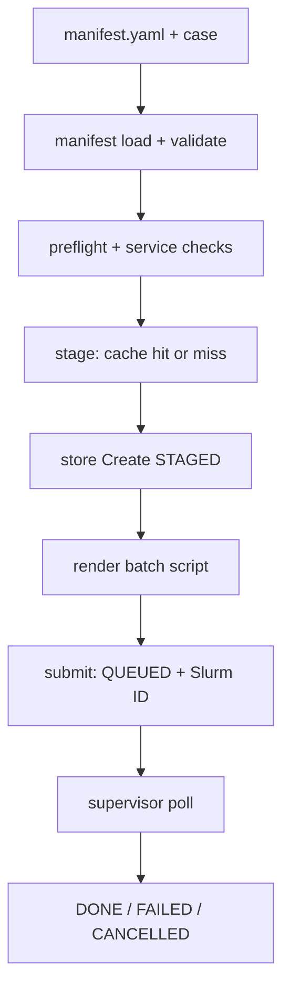
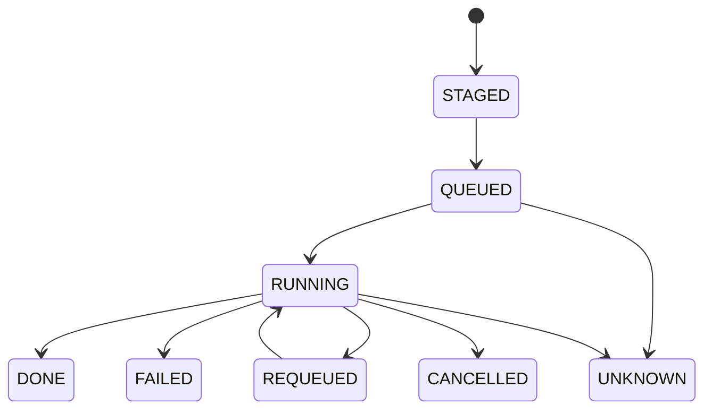
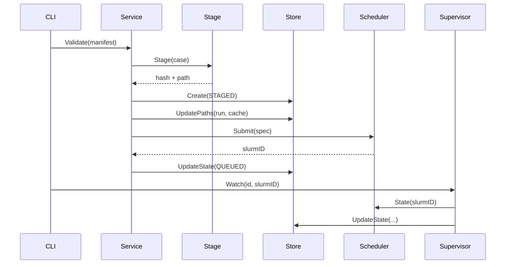

<!-- Audience: (3) a contributor or hiring manager reading the repo. -->
# Architecture

## Pipeline

## Local state machine

## `run` sequence

The CLI progress observer prints one timestamped stderr line per
completed stage; the live view forwards the same events to the TTY.

## Package map

`cmd/sluice` (Cobra commands, human output on stderr, data on
stdout) -> `internal/service` (orchestration + script render) ->
`manifest`, `preflight`, `stage`, `store`, `scheduler` or root
`client.go` (REST), `supervisor`, `telemetry`. `internal/brand`
holds every product name. `internal/doctor` checks the environment.
`internal/ui` holds banner, tables, and the live view.

## Data model

`jobs(id, name, state, manifest_path, case_hash, run_path,
cache_path, slurm_id, error, updated_at)`, indexes on `updated_at`
and `state`. SQLite WAL, single connection.

## Crash semantics (verified in code)

- Die after `Create(STAGED)` but before submit: a `STAGED` row with
  no Slurm job. Nothing reconciles it today: it stays `STAGED`
  until an operator deletes or resubmits.
- Die after Slurm accepted but before the `QUEUED` update: the job
  runs on the cluster with no local record of its Slurm ID. Nothing
  reconciles it today.
- Die during watch: the row keeps its last state; re-running
  `status --refresh` or `watch` resumes polling that job.
- Not reconciled on restart: orphan `STAGED` rows, submit/update
  races, and outbox events (there is no outbox). See
  [roadmap](roadmap.md).
